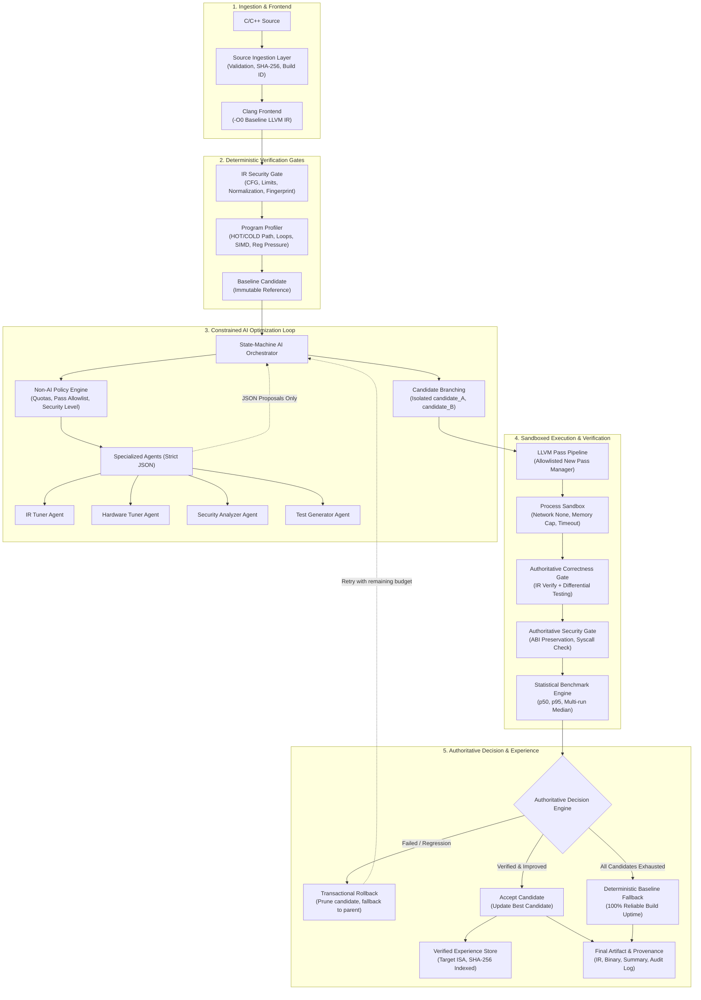
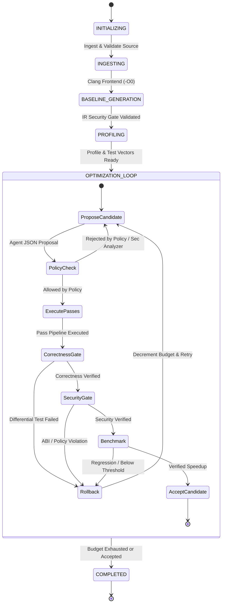

# Secure, Deterministic, Modular Agentic AI Compiler Architecture

## 1. Executive Summary & Core Principle

The **Secure Agentic AI Compiler** redesigns autonomous compilation from an unrestricted, heuristic AI pipeline into a **zero-trust, authoritative compiler infrastructure**. 

### The Core Architectural Invariant
$$\text{Correctness} > \text{Security} > \text{Reproducibility} > \text{Performance} > \text{AI Autonomy}$$

AI agents are **untrusted proposal generators**. They **NEVER** have direct authority over:
* LLVM IR text or abstract syntax trees
* Host process execution or shell invocations
* Filesystem, environment variables, or ambient secrets
* Network access or remote telemetry
* Compiler pass injection or toolchain binaries

All state mutations, candidate branches, pass executions, differential correctness testing, security auditing, and rollbacks are executed exclusively by the authoritative, non-AI deterministic compiler engine.

---

## 2. High-Level Architectural Flow



---

## 3. Detailed Component Breakdown

### 1. Source Ingestion Layer
* **Role**: Deterministic gatekeeper for input source code.
* **Responsibilities**:
  * Input validation: accepts `.cpp`, `.cxx`, `.cc`, `.c` up to 10 MB.
  * Assigns unique, timestamped build ID: `build_YYYYMMDD_HHMMSS_<hex>`.
  * Computes cryptographic `SHA-256` hash of original source.
  * Records immutable ingestion metadata: language standard, source bytes, timestamp.

### 2. Clang Frontend Wrapper
* **Role**: Authoritative producer of unoptimized baseline LLVM IR.
* **Responsibilities**:
  * Executes Clang inside an isolated subprocess sandbox.
  * Standard compilation flags: `-S -emit-llvm -O0 -Xclang -disable-O0-optnone -fno-discard-value-names -Wall -Wextra`.
  * Captures full compiler diagnostics, target triple, datalayout, and toolchain versions.
  * Produces immutable reference IR for downstream differential testing.

### 3. IR Security Gate
* **Role**: Deterministic static validation before any AI sees or optimizes IR.
* **Security Checks**:
  * **Module/CFG Consistency**: Verifies every basic block has valid terminators (`ret`, `br`, `switch`).
  * **Prohibited Constructs**: Blocks inline assembly (`asm sideeffect`), forbidden intrinsics, and direct kernel pointers.
  * **Resource Boundaries**: Enforces max IR size (10 MB), max instructions per function (100,000), max basic blocks per function (5,000).
  * **IR Fingerprinting**: Computes normalized `SHA-256` IR fingerprint.

### 4. Deterministic Program Profiler
* **Role**: Extracts structural, memory, and hardware characteristics directly from LLVM IR without relying on LLM inference.
* **Extracted Properties**:
  * **Path Classification**: Separates `HOT` path (latency-budgeted) from `COLD` path (setup, logging, teardown).
  * **Structural Metrics**: Loop depth, basic block count, overall branch density.
  * **Memory Operations**: Load/store frequency, `alloca` counts, memory-to-compute ratio.
  * **Hardware Vectorization**: Detects SIMD vectorization opportunities and floating-point intensity.
  * **Register Pressure**: Static estimation of peak live variables per basic block.
  * **Call Graph**: Inter-procedural call topology.

### 5. Non-AI Policy Engine
* **Role**: Authoritative rules engine with final veto power over all agent proposals.
* **Enforced Quotas & Bounds**:
  * Maximum compilation wall-clock time (default: 60s).
  * Maximum agent iterations (default: 4 iterations).
  * Maximum active candidate branches (default: 8 candidates).
  * Maximum IR growth threshold (+25% over baseline).
  * Maximum binary growth threshold (+15% over baseline).
  * Minimum statistical performance improvement threshold (+1.5%).
  * **Strict Pass Allowlist**: Restricts pass selection to verified, non-destructive transformations (`mem2reg`, `sroa`, `dce`, `instcombine`, `loop-vectorize`, `licm`, `gvn`, `simplifycfg`, etc.).
  * **Forbidden Passes**: Permanently blocks destructive or non-verifiable passes (`strip`, `internalize`, `mergefunc`).

### 6. State-Machine-Based AI Orchestrator
* **Role**: Coordinates the optimization workflow using a constrained finite-state machine.
* **FSM States**:
  $$\text{INITIALIZING} \longrightarrow \text{INGESTING} \longrightarrow \text{BASELINE\_GEN} \longrightarrow \text{PROFILING} \longrightarrow \text{OPT\_LOOP} \longrightarrow \text{COMPLETED}$$
* **Constraints**:
  * Cannot directly execute arbitrary shell commands.
  * Cannot directly mutate the production or baseline IR.
  * Maintains optimization budget and handles candidate retry/rollback transactions.



### 7. Specialized Constrained Agents
All agents communicate exclusively via typed, structured JSON schemas:

#### A. IR Tuner Agent
* Proposes phase-ordered LLVM pass sequences based on profiler hotness, loop depth, and memory operations.

#### B. Hardware Tuner Agent
* Proposes ISA-specific transformations: SIMD vectorization width, unroll factors, cache-line alignment (`alignas(64)`), and instruction scheduling.

#### C. Security Analyzer Agent
* Evaluates proposed transformations against undefined behavior (UB), signed integer overflow, division by zero, and race conditions.

#### D. Test Generator Agent
* Deterministically synthesizes differential test vectors based on program parameter types (boundary numbers, NaN/Inf, empty arrays, edge ticks).

```json
{
  "action": "propose_pass_pipeline",
  "agent_name": "IRTunerAgent",
  "passes": ["mem2reg", "sroa", "dce", "instcombine", "loop-vectorize"],
  "parameters": {"loop_unroll_count": 4},
  "expected_benefit": 35.0,
  "risk": "low",
  "reason": "Eliminates hot-path heap allocations and enables 4x SIMD vectorization"
}
```

### 8. Isolated Candidate Branching
* The authoritative baseline IR is frozen as an immutable reference.
* Every optimization strategy branches into an isolated, independent node:
  * `baseline` (Parent: `None`, Status: `VERIFIED`)
  * `candidate_1_irt` (Parent: `baseline`, Status: `ACCEPTED` / `ROLLED_BACK`)
  * `candidate_2_hwt` (Parent: `baseline`, Status: `ACCEPTED` / `ROLLED_BACK`)
* Each candidate maintains: unique candidate ID, cryptographic IR fingerprint, pass pipeline, parent ID, execution time, and verification report.
* If a candidate fails any gate, transactional rollback prunes the branch and restores state without contaminating other strategies.

### 9. LLVM New Pass Manager Execution
* Pass pipelines are mapped to LLVM's New Pass Manager (`opt`).
* Fully deterministic pass pipelines recorded verbatim for reproducibility.
* Unknown, unverified, or arbitrary pass names are rejected before execution.

### 10. Authoritative Correctness Gate
* **Core Rule**: Performance improvement can never compensate for incorrect output.
* **Three-Tier Verification**:
  1. **IR Syntax & Consistency**: `llvm-as` validation of the output IR.
  2. **Compilation Integrity**: Clang compilation of candidate IR to machine binary.
  3. **Differential Execution Testing**: Executes test vectors against **both** baseline and candidate binaries, asserting 100% equivalence on return codes, standard output, standard error, and computed numerical outputs.

### 11. Authoritative Security Gate
* Post-optimization inspection verifying:
  * **ABI Preservation**: Exported symbol names, parameter counts, calling conventions, and struct layouts remain identical.
  * **Prohibited Syscalls**: Scans disassembly for disallowed kernel traps or injected syscalls.
  * **Resource Caps**: Verifies candidate does not exceed binary growth limits (+15%).

### 12. Process Sandbox
* All pass executions, test runs, and benchmarks occur in an isolated execution sandbox:
  * Network isolation (`network=none`).
  * Process time quotas and timeouts.
  * Stripped environment variables (no host secrets, SSH keys, or cloud credentials).
  * Ephemeral sandbox directories deleted upon task completion.

### 13. Statistical Benchmark Engine
* Evaluates latency using multi-run statistical distributions (p50, p95, median, variance).
* Discards initial warm-up runs to eliminate JIT/OS jitter.
* Rejects candidates whose speedup falls below the statistical significance margin (1.5%).

### 14. Decision Engine
* Combines reports from Correctness Gate, Security Gate, Benchmark Engine, and Policy Engine.
* Emits unequivocal verdicts: `ACCEPT`, `REJECT`, or `ROLLBACK`.

### 15. Verified Experience Store
* Stores verified, accepted pass sequences indexed by target architecture and source hash.
* **Poison Prevention**: Failed, unverified, or rolled-back proposals are rejected from the experience store.

### 16. Artifact & Provenance Manager
* Preserves complete cryptographic provenance for every build in `compiler_artifacts/<build_id>/`:
  * `baseline.ll`: Unoptimized reference IR.
  * `optimized.ll`: Final verified LLVM IR.
  * `build_summary.json`: High-level build metrics, passes applied, and gate verdicts.
  * `audit_log.json`: Complete, immutable event stream.

### 17. Observability & Immutable Audit Trail
* Every decision, proposal, policy evaluation, verification report, and rollback is appended to an immutable JSON audit log.
* Enables auditing, regression diagnosis, and zero-trust verification.

### 18. Deterministic Baseline Fallback
* If all AI-generated candidates fail validation, time out, or if AI agents are disabled (`--no-ai`), the compiler engine **safely and automatically defaults to the verified baseline**.
* Guarantees 100% build reliability and prevents compiler stalls.

---

## 4. Verification Gate Matrix

| Verification Gate | Validation Mechanism | Authoritative Invariant | Failure Action |
| :--- | :--- | :--- | :--- |
| **IR Security Gate** | Static IR parser & regex validator | Malformed IR, inline assembly, and illegal memory ops rejected | Ingestion aborted |
| **Policy Engine** | Non-AI pass whitelist & resource quota check | Only allowlisted passes permitted; bounds respected | Proposal vetoed |
| **Correctness Gate** | Differential testing against `-O0` baseline | 100% semantic and numerical output equivalence | Transactional rollback |
| **Security Gate** | ABI and symbol table diff | No exported symbol mutations, ABI changes, or injected syscalls | Transactional rollback |
| **Benchmark Engine** | Multi-run p50/p95 statistical validation | Speedup must exceed 1.5% margin without regressions | Candidate rejected |

---

## 5. Directory Structure & Implementation Map

```
secure_compiler/
├── frontend/
│   ├── ingestion.py                 # Source validation, SHA-256, build IDs
│   └── clang_frontend.py            # Authoritative Clang wrapper (-O0 baseline)
├── ir/
│   ├── validator.py                 # Deterministic IR security gate
│   └── profiler.py                  # Static CFG, loop, memory, & SIMD profiler
├── policy/
│   └── policy_engine.py             # Pass allowlists, quotas, & security levels
├── orchestrator/
│   ├── orchestrator.py              # State-machine AI compiler coordinator
│   └── decision_engine.py          # Multi-gate evaluation & verdicts
├── agents/
│   ├── base.py                      # Constrained JSON agent protocol
│   ├── ir_tuner.py                  # Pass pipeline proposal agent
│   ├── hw_tuner.py                  # Hardware & SIMD tuning agent
│   ├── security_analyzer.py         # Dangerous transformation auditor
│   └── test_generator.py            # Differential test case generator
├── optimizer/
│   ├── candidate.py                 # Candidate tree & isolated branching
│   └── pass_pipeline.py             # LLVM New Pass Manager execution
├── verification/
│   └── correctness_gate.py          # Differential testing against baseline
├── security/
│   └── security_gate.py             # ABI preservation & security checks
├── sandbox/
│   └── sandbox.py                   # Process isolation, timeouts, env scrubbing
├── benchmark/
│   └── benchmark_engine.py          # Multi-run statistical performance engine
├── experience/
│   └── experience_store.py          # Verified, poison-resistant pattern store
├── artifacts/
│   └── artifact_manager.py          # Provenance, artifacts, and summary storage
├── observability/
│   └── audit_log.py                 # Immutable audit logging engine
├── web_ui/
│   ├── server.py                    # Threaded zero-dependency dashboard server
│   ├── serializer.py                # Rich dashboard data transformation
│   └── static/
│       ├── index.html               # Enterprise compiler dashboard UI
│       ├── style.css                # Enterprise white-theme design system
│       └── app.js                   # Reactive data visualization client
└── tests/
    ├── test_ir_validator.py         # IR security gate test suite
    ├── test_policy_engine.py        # Policy enforcement test suite
    ├── test_candidate_branching.py  # Branching and rollback test suite
    ├── test_correctness_and_security.py # Correctness & ABI gates test suite
    ├── test_sandbox_and_benchmark.py # Sandbox and benchmark test suite
    └── test_orchestrator_and_deterministic_fallback.py # FSM & fallback test suite
```
